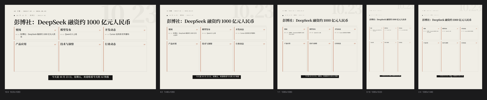
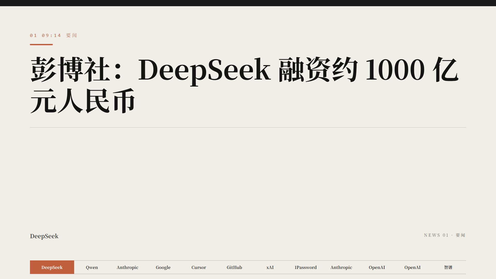
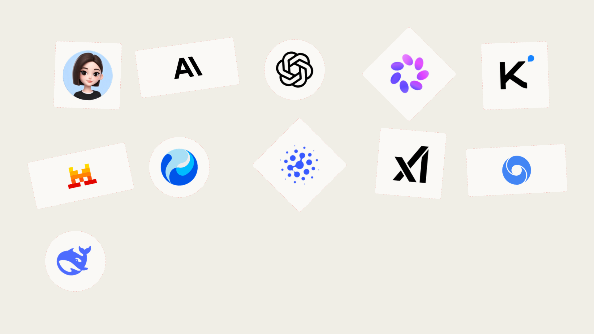
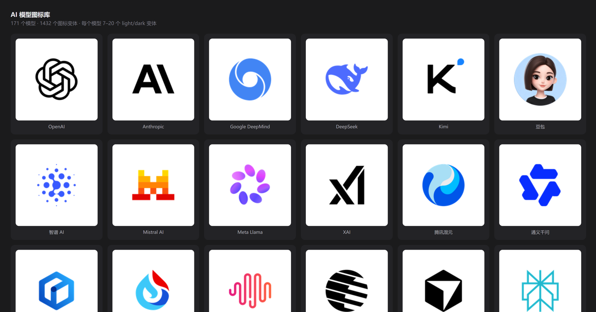
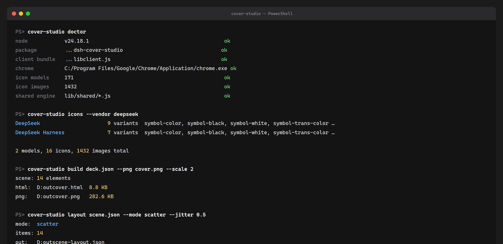

# dsh-cover-studio

**AI 日报封面工作台** — DeepSeek Harness 全页插件 + 完整 CLI。

用 AI 模型图标、分类卡片、数据块拼出像素级对齐 AI 日报 Skill 版式的封面与新闻页。
三种驱动方式：**图形界面**、**命令行**、**Agent 工具**，走的是同一套渲染引擎，输出完全一致。


---

## 目录

- [它做什么](#它做什么)
- [安装](#安装)
- [三种用法](#三种用法)
- [CLI 命令参考](#cli-命令参考)
- [DSH 工具参考](#dsh-工具参考)
- [效果截图](#效果截图)
- [图标库](#图标库)
- [架构](#架构)
- [版式规格](#版式规格)
- [开发](#开发)

---

## 它做什么

| 能力 | 说明 |
|---|---|
| **封面工作台** | 无限画布、多画板、拖拽缩放旋转、吸附对齐 |
| **16 种元素** | 日期水印 / 顶栏 / 元信息行 / 大标题 / 副标题 / 分隔线 / 分类卡 / 眉标 / 强调条 / 正文 / 导语 / 要点列表 / 数据块 / 字幕 / 标签带 / 页脚 |
| **图标库** | 171 个 AI 模型、1432 个变体、109 个厂商分组 |
| **打散排布** | 正方形 / 长方形 / 圆形 / 菱形混合随机排布 |
| **5 种画布比例** | 16:9 / 4:3 / 1:1 / 9:16 / 3:4，版式随比例自适应 |
| **像素级对齐** | 字号、字距、行高、内边距全部取自 AI 日报 Skill 的样式表 |
| **导出** | 单页 HTML、多页 HTML、PNG（2×/3×/4×） |
| **CLI** | 全部功能可在终端调用，退出码可组合进流水线 |
| **Agent 工具** | 5 个 DSH 工具，Agent 无需 shell、无需浏览器即可驱动 |

---

## 安装

### 作为 DSH 插件

```bash
cp -r dsh-cover-studio ~/.dsh/profiles/desktop/node_modules/@local/dsh-cover-studio
# 重启 DSH，侧边栏出现「封面工作台」
```

### 作为 CLI

```bash
# 从仓库直接运行
node dsh-cover-studio/lib/cli.js doctor

# 或全局安装
cd dsh-cover-studio && npm link
cover-studio doctor
```

### 依赖

| 依赖 | 必需 | 说明 |
|---|---|---|
| Node.js ≥ 22 | ✅ | 用了 ESM 和 fetch |
| Chrome / Edge | 仅导出 PNG | 自动探测；找不到时设 CHROME_PATH |

---

## 三种用法

### 1. 图形界面

DSH 侧边栏 → **封面工作台**。

```
┌─────────────┬──────────────────────────┬─────────────┐
│ 模型图标     │                          │  属性        │
│ 文字         │       无限画布            │  位置尺寸    │
│ 排布         │   （多画板 / 吸附 / 缩放） │  外观        │
│ 图层         │                          │  文字        │
└─────────────┴──────────────────────────┴─────────────┘
```

**框选规则**（两套互不干扰）：

| 鼠标落点 | 框选对象 | 判定方式 |
|---|---|---|
| 封面卡片内 | 卡片里的图标和文字 | Photoshop 语义：碰到图形的不透明像素就选中 |
| 画布点状背景 | 画布上的卡片节点 | 相交判定 |

图标的透明边距不算命中——这是通过采样 alpha 通道实现的，见 [架构](#架构)。

### 2. 命令行

```bash
# 检查环境
cover-studio doctor

# 列出图标库
cover-studio icons --vendor deepseek

# deck → 单页 HTML + PNG
cover-studio build deck.json --png cover.png --scale 2

# deck → 多页滚动 HTML（封面 + 每页新闻 + 片尾）
cover-studio deck deck.json -o all.html

# 打散排布
cover-studio layout scene.json --mode scatter --jitter 0.5

# 查看场景几何
cover-studio inspect scene.json
```

### 3. Agent 工具

插件启动时向 DSH 注册 5 个工具，Agent 可以直接调用：

```
cover_studio_build    deck → HTML，返回元素数与路径
cover_studio_deck     deck → 多页 HTML
cover_studio_layout   重新排布 scene（scatter/grid/row/align）
cover_studio_inspect  scene 几何摘要
cover_studio_icons    查询图标库
```

Agent 调用示例：

```js
const r = await tools.cover_studio_build({
  deck: { brand: 'AI 日报', date: '2026-10-23', news: [...] },
  out: '/tmp/cover.html'
});
// → { ok: true, elements: 14, path: '/tmp/cover.html', bytes: 8721 }
```

---

## CLI 命令参考

```
cover-studio <command> [options]

COMMANDS
  list [--dir templates]             列出内置 HTML 模板
  icons [--vendor <name>] [--json]   列出 AI 模型图标库
  build <deck.json> [-o out.html]    deck → scene → 单页 HTML
        [--png out.png] [--scale 2]  …并用无头 Chrome 栅格化
  render <deck.json> -o out.png      deck → PNG
  deck <deck.json> [-o out.html]     deck → 多页滚动 HTML
  layout <scene.json> --mode <m>     重新排布场景
        mode: scatter | grid | row | align
        scatter: --shapes square,rect,circle,diamond --jitter .3 --rotate 12
        grid:    --cols 3 --gap 24
        row:     --gap 24
        align:   --how left|centerX|right|top|centerY|bottom
  inspect <scene.json>               打印元素几何表
  doctor                             报告能力状态
```

**退出码**：成功 `0`，失败 `1`。可直接用于 `&&` 链或 CI。

### deck.json 格式

```json
{
  "brand": "AI 日报",
  "brandLatin": "DAILY AI",
  "date": "2026-10-23",
  "tone": "paper",
  "topic": "模型 · 产品 · 安全 · 政策",
  "cover": { "headline": "彭博社：DeepSeek 融资约 1000 亿元人民币" },
  "news": [
    {
      "category": "要闻",
      "timecode": "09:14",
      "headline": "彭博社：DeepSeek 融资约 1000 亿元人民币",
      "entity": "DeepSeek",
      "summary": "导语段落…",
      "bullets": ["要点一", "要点二"],
      "metrics": [{ "value": "816", "unit": "B", "label": "总参数量" }]
    }
  ]
}
```

固定分类顺序：`要闻 / 模型发布 / 开发动态 / 产品应用 / 技术与洞察 / 行业动态`。

---

## DSH 工具参考

### cover_studio_build

| 参数 | 类型 | 必需 | 说明 |
|---|---|---|---|
| `deck` | object | ✅ | deck 对象 |
| `out` | string | | 输出 HTML 路径 |
| `ratio` | `16:9` / `4:3` / `1:1` / `9:16` / `3:4` | | 画布比例 |

返回：`{ ok, elements, path, bytes, ratio }`

### cover_studio_deck

| 参数 | 类型 | 说明 |
|---|---|---|
| `deck` | object | deck 对象 |
| `out` | string | 输出路径 |
| `gap` | number | 页间距，默认 24 |

返回：`{ ok, pages, path, bytes }`

### cover_studio_layout

| 参数 | 类型 | 说明 |
|---|---|---|
| `scene` | object | 含 `elements` 数组 |
| `mode` | `scatter` / `grid` / `row` / `align` | 排布方式 |
| `shapes` | string[] | scatter 专用 |
| `jitter` | number | scatter 专用，0 整齐 … 0.5 混乱 |
| `rotate` | number | scatter 专用，最大旋转角度 |
| `cols` / `gap` / `how` | | 其他模式 |

返回：`{ ok, mode, moved, scene }`（scene 已就地更新）

### cover_studio_inspect

返回：`{ ok, count, bounds, elements[] }`

### cover_studio_icons

| 参数 | 说明 |
|---|---|
| `query` | 按模型名模糊匹配 |

返回：`{ ok, models, icons: { 模型名: [变体…] } }`

---

## 效果截图

### 封面


### 五种画布比例

16:9 / 4:3 / 1:1 / 9:16 / 3:4，版式随比例自适应。



### 新闻页



### 打散排布

正方形 / 长方形 / 圆形 / 菱形混合，带随机旋转。



### 图标库



### CLI



---

## 图标库

```
171 个模型 · 1432 个图标 · 109 个厂商分组
```

每个模型带 7–20 个变体：

| 变体 | 用途 |
|---|---|
| `symbol-color` | 彩色标志，浅色底 |
| `symbol-black` / `symbol-white` | 单色标志 |
| `symbol-trans-color` / `-black` | 透明底 |
| `wordmark-color` / `-black` | 字标 |
| `tile-light` / `tile-dark` | 方形磁贴 |

```bash
cover-studio icons                        # 全部
cover-studio icons --vendor deepseek      # 按厂商
cover-studio icons --json                 # 机器可读
```

---

## 架构

```
lib/
├── index.js              Host 半：工具注册 + HTTP 路由 + Skill 桥
├── client.js             Browser 半：完整编辑器（含内联图标）
├── cli.js                命令行入口
└── shared/               两侧共用的纯函数
    ├── layout.js         boundsOf / alignBoxes / gridArrange / scatterArrange
    ├── scene.js          deckToScene / buildPageElements
    └── render.js         renderPage / renderDeck（静态 HTML）
```

**关键设计**：`lib/shared/` 是纯函数，不碰 DOM、不碰 React、不碰 Node API。
浏览器、CLI、Agent 工具三条路径都调用它，所以同样的 deck 永远得到同样的几何。

### 框选的 alpha 采样

图标的 `` 包围盒大部分是透明边距。实测 DeepSeek 图标：

```
尺寸 128×128
实际图形:  x 9.4%..90.6%   y 19.5%..78.9%
有效像素:  仅占包围盒 25.4%
```

所以命中测试不用包围盒，而是把图标画到 64×64 canvas 上、扫描 alpha 通道、
求出紧致矩形，缓存成 `{ x0, y0, x1, y1 }` 分数。这样擦到图形边缘就选中，
擦到透明边距不选中——和 Photoshop 一致。

---

## 画布比例

| 比例 | 尺寸 | 用途 |
|---|---|---|
| `16:9` | 1920×1080 | 横屏视频、B 站/YouTube 封面 |
| `4:3` | 1440×1080 | 传统横屏、PPT 内嵌 |
| `1:1` | 1080×1080 | 小红书/Instagram 方图 |
| `9:16` | 1080×1920 | 抖音/Reels/Shorts 竖屏 |
| `3:4` | 1080×1440 | 竖版海报、朋友圈 |

版式随比例自适应：

- **位置**按 `KX = W/1920`、`KY = H/1080` 缩放
- **字号**按 `KS = min(KX, KY)` 缩放（取较短边，否则竖屏标题会撑爆）
- **标题高度**按字形估算换行数，换行时下推分隔线与卡片
- **卡片高度**按「分隔线到字幕之间剩余空间」反推，永不压到字幕
- **字幕宽度**按实际字形宽度计算，上限随画布收窄

```bash
cover-studio render deck.json -o a.png --ratio 1:1 --scale 2
```

---

## 版式规格

全部取自 AI 日报 Skill 的样式表，不是估算值：

| 变量 | 值 | 用途 |
|---|---|---|
| `--pad-x` | 116px | 左右页边距 |
| `--pad-t` | 64px | 上边距（封面 72px） |
| `--strip-h` | 52px | 标签带高度 |
| `--cap-h` | 62px | 字幕牌高度 |
| `--strip-b` | 44px | 标签带距底 |
| `--cap-b` | 116px | 字幕距底 |
| `--foot-b` | 204px | 页脚距底 |
| `--body-b` | 258px | 正文区距底 |

字体栈：

```css
--f-serif:   "Noto Serif SC","Source Han Serif SC",Georgia,serif
--f-display: "Playfair Display","Noto Serif SC",Georgia,serif
--f-sans:    "Noto Sans SC",system-ui,sans-serif
--f-mono:    "IBM Plex Mono","JetBrains Mono",Consolas,monospace
```

---

## 开发

```bash
npm run check     # 语法检查全部模块
npm run doctor    # 环境自检
npm run cli -- icons --vendor openai
```

| 文件 | 说明 |
|---|---|
| `lib/client.js` | 编辑器主体，图标库内联于此 |
| `lib/shared/layout.js` | 排布算法，可独立测试 |
| `lib/shared/scene.js` | deck → 元素列表 |
| `lib/shared/render.js` | 元素列表 → HTML |

---

## 许可

MIT

---

## 相关

- [DeepSeek Harness](https://github.com/deepseek-ai)
- AI 日报 Skill — 版式与数据格式的来源
